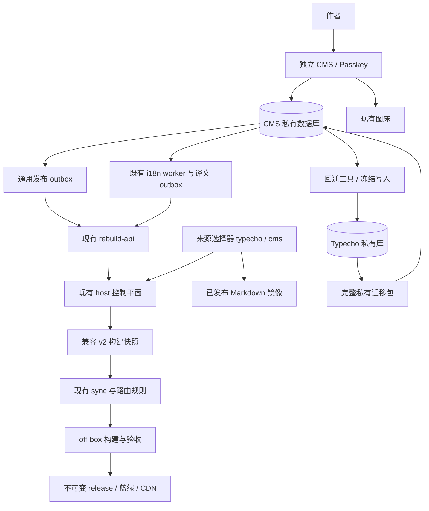

# andy-blog 自研 CMS 方案 v2

日期：2026-10-10。状态：设计修订完成，尚未实施。配套文件：[Agent 执行计划 v2](agent-plan-v2-2026-10-10.md)。

本版依据两份 v1 文档和本地仓库审计修订。它是完整替代版本；“已定”表示本版设计选择，不表示功能已实现、用户试用通过或生产部署获准。编写 v2 的授权仅覆盖文档。

仓库归档：2026-10-11。维护入口：[CMS 文档索引](README.md)。当前仍使用 Typecho；本文件中的新增目录、脚本与配置均为实施目标。

## 1. 目标与范围

建设单用户的窄 CMS，替换 Typecho 的写作、翻译审批和重建触发职责。访客继续读取 Astro 静态站；评论继续使用 Waline；生产继续采用 off-box 构建、不可变 release、checksum 校验、蓝绿切换和现有 CDN。

CMS 向构建链提供兼容的 `schemaVersion: 2` JSON。**保持快照后的内容转换及发布语义，允许明确列出的来源接入改动**，不再承诺所有 host 脚本一行不改。对同一内容状态、相同 epoch 和相同路由基线，新旧来源须产出相同 Markdown；最终验证完整构建输出。

MVP 包括：passkey 登录与凭据管理、受限恢复流程、文章/页面 CRUD、分类标签、自定义字段、修订与恢复、图片转传、两层预览、i18n 审批、通用发布 outbox、完整迁移/回迁工具和部署 runbook。已有 Moments 完整迁入并继续构建；移动发布面板在 P4 切换后开发，期间暂停新增闲话。

不做：评论系统替换、多用户权限、插件系统、前台主题重做、富文本编辑器、XML-RPC 等传统协议。定时发布、后台全文搜索、草稿分享和 AI 写作辅助后置。HTML 存量保留并只读展示，不新增 HTML 编辑器。

## 2. 本版主要决定

| 项目 | v2 决定 |
| --- | --- |
| 后台 | 独立 `cms/`，Astro SSR + `@astrojs/node`，与 `astro/` 分开构建；API 使用 endpoints/middleware |
| 运行时 | Node 满足仓库 `>=22.12` 要求；具体 Node、Astro、adapter 和依赖版本在 P0 固定，按兼容结果升级 |
| 数据库 | 复用 1Panel MySQL 服务，新库、`cms_` 前缀、独立账户；不读取 Waline 库 |
| 查询 | 优先复用 `mysql2` 与参数化 SQL；不为本次迁移额外引入 ORM |
| 数据兼容 | `text/allowComment/allowFeed/order` 等沿用 Typecho 兼容列名；正文保留 `<!--markdown-->` 标记及原始换行 |
| 短代码 | 导入时不批量转换 Joe 短代码；旧语法原样保留，新内容推荐 `:::`；转换仅用于渲染副本 |
| 编辑器 | CodeMirror 6 + 装饰层，提供源码模式；字节保真须通过保存链路验证，不视为库的自动保证 |
| 预览 | 复用正文转换和渲染规则，显式区分互动预览与正式构建渲染；不在生产 VPS 的输入循环启动 Playwright |
| 图片 | 服务端转传现有 Lsky Pro，记录去重信息；旧 `/usr/uploads/` 静态路径与文件保留 |
| 登录 | 公网独立子域；离线初始化首个管理员，普通登录使用 passkey；已登录用户可管理多个凭据 |
| 发布 | 通用 `cms_publish_outbox` 与既有 `cms_i18n_publish_outbox` 分离，复用 rebuild-api 协议 |
| 部署 | 生产 VPS 独立 CMS 容器；回滚窗口内保留停写的 Typecho 容器与数据库，不立即删除 |
| 修订/备份 | CMS 修订全量保留；数据库私有备份与已发布 Markdown 镜像分开；后者继续沿用现有内容仓库 |

## 3. 已核对事实与实施前待核实事项

本地代码证据：

- `scripts/export-typecho-snapshot.js` 固定查询 `typecho_*`，输出 v2 快照；`host/blog-rebuild-1panel.sh` 与 `host/backup-content-github.sh` 直接调用它。
- `scripts/lib/i18n-snapshot.js` 只导出 head 当前批准的译文版本；head 仍可能带 `draft_version_id`。job/outbox 不在构建快照中。
- `scripts/lib/i18n-store.js` 的源文查询依赖 `contents.text`；worker 根据 `sourceHash(title, text)` 验证任务。
- `scripts/i18n-migrate.js` 定义六张 i18n 业务表；i18n outbox 要求 cid、locale 和译文 version_id，不能充当分类标签队列。
- `markdown-pipeline.mjs` 提供渲染入口，但 Mermaid 使用 file 策略；缓存与 SVG 依赖磁盘，未命中涉及浏览器渲染。文章外壳部分逻辑在 `astro/src/pages/posts/[id].astro`。
- 两份旧 `snapshot-*.json` fixture 均无 schemaVersion/i18n，其中一份含 attachment；旧字段不止五个专用字段。

实施前核实：生产表结构与触发器、全部 type/status/字段值、草稿及 HTML 数量、Moments/附件引用、所有 i18n 版本与队列状态、现有 MySQL 备份/恢复能力、Lsky 版本与返回协议、实际 OpenResty/CSP/上传目录和容器网络。不得沿用 v1 的“23 篇”“19 处短代码”作为当前已验证事实。

生产 SSH/MySQL 按仓库约束默认可读；导出应使用现有一致性快照机制，控制读取负载。写库、创建账号、安装容器、启用影子任务、触发重建、切换 release、清 CDN 均需当次明确授权。

## 4. 架构与变更边界

允许的接入改动：新增统一导出入口 `scripts/export-content-snapshot.js`，由 `CONTENT_SOURCE=typecho|cms` 选择来源，默认 typecho。正式构建和内容备份共用同一来源配置与导出入口；CMS 导出使用明确的 CMS 只读账户和库名。不得在失败时静默切回另一来源。

`host/blog-rebuild-1panel.sh`、`host/backup-content-github.sh`、相关 compose/env 和观察任务允许调整来源接入、挂载和数据库配置。两套数据库连接显式区分；密码留在部署侧 secret，不能靠修改同一个 DB_NAME 隐式切换。worker 设置 `DB_PREFIX=cms_`；发布观察同步设置 CMS 库与 `I18N_OBSERVE_PREFIX=cms_`，回滚时成组切回。

`sync-typecho.js` 保留原内容/路由语义；只允许输入契约验证与兼容入口接线。共享渲染参数和文章展示组件可抽取，但不得改变访客行为；渲染文件变化导致 fingerprint 更新时，按现有规则重新验证，不能把旧验证结果伪装为有效。

rebuild-api 协议、off-box 发布机制、各 gate 判定、CDN、Waline 保持。若实际代码要求超出这些接入改动，应记录原因和具体差异，再由用户确定范围，不绕过 gate。

## 5. 两类数据产物

### 5.1 构建快照：兼容现有 schemaVersion 2

包含 `snapshotEpoch`、`schemaVersion: 2`、`contents`、`relations`、`fields`、`metas`，以及存在 i18n 时的 `sourceState/heads/versions/ledger`。contents 保持现导出器的 post/page/post_draft 范围，versions 只含当前 approved 指针指向的版本。

现契约中 contents 可以包含源文草稿，并不代表 sync 会公开它们；i18n 未批准译文正文不加入构建快照。快照整体仍按私有构建输入保护，不发布到公网或提交 Git。

保留 `cid/mid/version_id`、秒级时间戳、类型、null/空串、字段三种值列及排序。转换 BigInt 时超出安全整数范围必须报错，不无声舍入。字段表保留 `str_value/int_value/float_value`，不能用单一 value 丢掉类型。relations 输出含 meta 派生字段，不能仅导出关系主键。

### 5.2 私有迁移包：完整后台状态

另设 `migrationPackageVersion: 1`，不修改公开构建契约。包内含 manifest、表结构版本、每表行数/主键范围/内容 hash、源状态标识、完整 contents/metas/relationships/fields、六张 i18n 业务表全部行、迁移版本记录、所需附件元数据，以及旧上传文件清单和 checksum。manifest 对每张参与迁移的自增表记录表/身份域、源 next ID、采集时点和读取方式；序列值按精确十进制值保存，不经 JS Number 舍入。源 next ID 不能从现存行的 max(id) 推算。

完整 contents 保留草稿、私密、密码内容及识别出的附件等类型。非 MVP 可编辑类型保存在兼容表或只读兼容区域；未知类型不得默默过滤。attachments/其他额外列的存储与回迁映射根据 P0 实际 inventory 固定。

迁移包不复制 Typecho 管理员密码、会话、插件密钥和图床 token；设置依赖单列配置 inventory，所需密钥走部署 secret。旧账户不用于 CMS 登录。

私有包通过受限文件路径交付，权限与备份按敏感数据处理，不提交仓库或放入静态目录。导出采用一致性读取；若源表无法保证事务一致性，改用明确维护窗口，不声称跨非事务表快照一致。

## 6. 数据模型与原文保真

| 表 | 要求 |
| --- | --- |
| `cms_contents` | 保存现有导出列，`text` 存储原文和标记；扩展列承接完整迁移所需的 Typecho 信息；保留 cid，导入后按源序列、目标已消耗序列和历史保留身份校准 AUTO_INCREMENT，禁止下调 |
| `cms_metas/cms_relationships/cms_fields` | 保留 mid、关系、order/count 和值类型；导入所有旧字段，界面新增/编辑白名单与存储兼容分开 |
| `cms_content_revisions` | 保存标题、正文、slug、状态、可见性、时间、开关、全部字段与关系的完整版本；恢复也是新事务、新修订和按需发布 |
| 六张 `cms_i18n_*` | 与现有 i18n 表结构/语义兼容；保留 version_id、revision、hash、head 指针、ledger 和队列 |
| `cms_publish_outbox` | 通用发布事件、稳定事件 ID、变更序号、状态、租约、次数、重试时间和错误 |
| `cms_change_log/cms_import_runs` | 记录新增/修改/删除的顺序、影子包标识、导入完成状态与来源；支持删除对账和回迁 |
| `cms_media` | 图床 URL、编码后 sha256、mime、尺寸、创建时间；不承诺迁移第三方图床文件 |
| `cms_auth_credentials/cms_sessions` | 多个凭据、challenge/会话状态、过期/撤销；具体 WebAuthn 字段按锁定依赖版本保存 |
| `cms_audit_log` | 应用只追加操作日志；敏感 secret 不入日志，不宣称应用可写库具备防篡改审计能力 |

专用字段控件覆盖 `astroPath/content_kind/moment_images/moment_topics/thumb`，其他历史字段仍可导出及回迁。已发布 `astroPath` 继续按现有锁定规则处理。数据库采用 utf8mb4，禁止隐式截断；正文相等按 UTF-8 字节/hash 判断，不依赖数据库排序规则。

迁入、影子替换和回迁对每张自增表取以下值的最大值作为 next ID 下界：包内源 next ID、目标库切换前的 next ID、最终行最大 ID + 1、该身份域历史保留 ID 最大值 + 1。P0 明确保留身份的来源和表间映射，包括 `data/route-map.json` / `data/meta-route-map.json` 的墓碑及仍需保留的 i18n/变更记录引用；不能把路由表排除在 CID/MID 约束之外。staging 替换前捕获目标序列，不因重建表或重跑导入而丢失。序列只升不降，source/target 差异按该规则逐表报告。MySQL 序列元数据不视为事务快照的一部分；影子导出记录读取时点并核验其不小于包内最大 ID + 1，最终导出在写入和在途任务均冻结后采集，不能声称仅靠一致性 SELECT 已冻结序列。

导入不做 trim、换行规范化、Markdown 标记重拼或短代码转换。因此 i18n source hash 和已有任务输入保持一致。新内容使用 Markdown；编辑器展示时从文档模型分离 marker，保存时精确保留原 marker 边界，不能用会吞空白的正则重建。

CodeMirror 按每文档换行配置 `lineSeparator`，序列化使用匹配接口。混合换行文本无改动保存返回原始字节；实际修改混合换行文本前提示并记录明确的规范化操作，不暗改。保真样本覆盖 CRLF/LF/CR、混合换行、尾部空行、硬换行空格、中文/emoji、代码围栏、数学和短代码。

保存使用乐观并发版本，过期版本返回冲突，不覆盖另一标签页的修改。修订恢复按同一并发规则执行。HTML 存量原样导入、只读、继续沿用现有下游格式；如要转 Markdown，逐篇显式转换并独立验证，不阻塞其余迁移或丢弃原文。

## 7. 保存、翻译与发布

### 7.1 保存事务

同一事务完成内容/字段/关系写入、完整修订、并发版本更新、change_log、i18n source_state 及按需 job、通用发布入队。草稿自动保存不触发公开构建；已发布内容编辑、发布、撤回、删除，以及影响公开输出的分类标签/字段变动需要入队。私密状态继续遵循现有 sync 的筛选语义。

i18n 保存、审批、禁用、恢复及 CAS 规则对照现有 Plugin/Action 实现，不只照抄面板 UI。保留旧 source_revision/source_hash，不因迁移伪造新内容修订。Moments 继续排除翻译任务。未改变正文格式时，worker 的源文 SQL 与 hash 函数原样复用。

### 7.2 两个 outbox

通用队列承接中文内容和 metadata 变更；译文队列继续承接具体 locale/version_id。二者不共用伪造 cid/version_id。

通用队列消费者使用 MySQL 租约领取并恢复崩溃任务，提交数据库事务后发请求。发送沿用 `event: typecho-content-changed`、Unix 秒 ts、32 位 hex nonce 和原始 body 的 HMAC。每次发送重试生成新的 ts/nonce；数据库事件 ID 保持稳定。网络超时意味着结果未知，允许至少一次投递；不将 nonce 防重放当作业务恰好一次投递。

定义通用状态 `pending/sending/accepted/failed`：租约超时回 pending，网络/5xx 按有上限的退避重试；身份/协议错误告警并待处理，不能永久无限刷请求。202 只说明 rebuild-api 接收入队。界面分别展示“内容已保存”“重建请求已接收”“构建/发布状态”；没有 release 对应证据时不能显示某次编辑已上线。

现有 debounce 合并连续请求，不保证永远只构建一次。译文上线继续由现有 release manifest 和观察器确认；通用发布 MVP 链接现有状态 UI，不声称具备精确逐修订上线确认。新增这类确认机制属于后续任务。

## 8. 编辑器与预览

CodeMirror 6 为文本模型，装饰层只改变视图。小众扩展可在 P1 试验，须核对实际版本、许可、更新情况和本项目语法，再决定纳入；v2 不沿用未经核实的“完全保真”“已冻结”“最新版本”结论。源码模式始终可用。旧 Joe 与 `:::` 指令都需可编辑，旧语法 widget 使用转换副本，不写回源文。

### 8.1 实时预览

输入停止约 300ms 是请求防抖，不是渲染耗时承诺。块级装饰允许脚注、引用式链接等跨块内容不精确，完整文档预览负责消除这类差异。

服务端先执行与 sync 相同顺序的正文展示转换，再使用共享 remark/rehype 规则。CMS 使用显式的 interactive 模式：替换会启动 Playwright 的 Mermaid file 插件，保留安全处理和可供浏览器渲染的图表占位；新 Mermaid 在隔离 iframe 内用本地 bundle 暂时渲染。该模式不写 off-box 的 beoe 缓存。

浏览器使用锁定的 Mermaid 配置与严格模式。已生成 SVG 缓存只有在建立只读缓存/资源映射后才能复用，不假设两台主机共享缓存。网易云补全、图片探测等外部读取使用超时、并发限制、缓存和失败占位；禁止任意内网/本机地址探测与未校验重定向。

取消过时的预览任务、限制正文大小和渲染并发，持续输入不无限堆积。CMS 容器只读根文件系统，确需缓存/临时文件时用容量受限的独立可写卷或 tmpfs；路径显式配置，不能落入源码或生产构建缓存。

### 8.2 与线上对齐的正式预览

标题、阅读时间、目录等逻辑先从现有页面抽成接受数据的展示组件，避免直接 import 静态路由和 `astro:content` 页面作为 SSR 预览。组件抽取保留线上输出和交互；Expressive Code 配置与主题共用。

“精确”仅指经过正式构建验证的渲染：对指定草稿执行隔离 off-box 构建，不切 release、不清 CDN，产物经鉴权查看。它是手动任务，不随每次输入运行，不把私密预览放入公开发布目录。启用真实 off-box 预览任务属于生产接入，需明确授权；本地先模拟。

实时预览显示 Mermaid 等临时差异，不承诺其与最终 SVG 字节一致。现有 Typecho 预览资源在回滚窗口内继续保留；所有调用方迁走前不得删除 `cms-preview-render.js`。

## 9. 登录、恢复与运行安全

首个管理员通过离线命令在受控环境创建：命令生成短时一次性 bootstrap secret，仅存 hash，限制有效期和使用次数。初始化页面须携带该 secret 并完成 passkey 注册；使用数据库唯一约束/锁保证只能初始化一次。初始化成功销毁 secret，关闭公开注册。空数据库不得意味着允许匿名注册。

常规登录验证一次性、限时、绑定当前流程的 challenge，以及固定 expectedOrigin/expectedRPID；要求 user verification。保存凭据 ID、公钥、计数器、user handle、transport 等所需字段，并按库规则更新。多个备用 passkey 的添加/撤销需已登录和近期再认证；不能删掉最后可用凭据而无恢复途径。

TOTP 不是常规登录旁路。用户登录后显式启用，secret 使用数据库之外的部署密钥加密，附一次性恢复码（只存 hash）。恢复须 TOTP 加未用恢复码，实施限速、时间窗与重放检查；只签发短时、仅限凭据重新绑定的会话。完成恢复撤销旧会话，相关凭据按确认撤销，通知并记录。完全丢失恢复材料时走离线管理员恢复工具，禁止公网重置注册。

会话 cookie 使用 `__Host-`、Path=/、无 Domain、HttpOnly、Secure、SameSite=Strict；12 小时滑动有效期，同时设置 7 天绝对上限。登录/恢复后旋转会话，登出/凭据变更可撤销。写接口校验 Origin 和 CSRF，初始化/恢复接口使用自身绑定流程及同源校验。

独立子域/server 块；OpenResty 与应用按可信代理后的真实来源限速。CSP 明确 script/style/frame/img/connect 规则，Astro 需要内联内容时使用 nonce/hash，不无条件复制 www CSP；图床图片和 sandbox 预览资源列入必要规则。iframe 默认 opaque origin，仅允许必需脚本，不能把同源特权与脚本执行一起授予不可信预览；消息校验 source 和会话绑定标识。

上传在认证、CSRF、请求体上限后处理：允许的 raster 类型、文件头、字节/像素/帧数上限和处理超时，sharp 重编码后计算去重 hash。MVP 拒绝 SVG；GIF 等动画的保留或拒绝明确提示，不无声变成静态图。token 只在服务端。应用 non-root、只读 rootfs，secret 不进入日志。

CMS CRUD、worker、导出、迁移分别使用最小权限账户；迁移 DDL 权限不留给日常应用。CMS 无生产 SSH 密钥，但其内容写权与 rebuild HMAC 足以影响站点内容，不能因此宣称无法影响发布。审计记录和已发布内容备份都不替代私有库备份及恢复演练。

## 10. 迁移、影子与回滚

### 10.1 阶段及判定

| 阶段 | 内容 | 完成证据 |
| --- | --- | --- |
| P0 契约/库存 | 两类契约、旧 fixture 升级、完整 inventory、对拍工具 | 新 v2 正反例；i18n/未知字段/附件覆盖；差异检测能发现故意错误 |
| P1 编辑器原型 | 文本、两层预览、基本保存链路 | 不改保存字节一致，编辑/撤销一致；用户真实写作手感确认 |
| P2 本地 MVP | CRUD、认证、两个 outbox、完整迁入与回迁 | worker/CAS/安全/崩溃重试验证；数据和构建对拍；新旧切换和回滚演练 |
| P3 影子 | 只读源导出、CMS 镜像、隔离构建 | 增改删/草稿/审批覆盖，来源适配与备份演练；生产观察另获授权 |
| P4 切换 | 冻结 Typecho、停队列、最终迁入、接入切换 | 最终对拍通过、写入端唯一、备份可恢复、真实发布观察 |
| P5 稳定/下线 | 观察、按需回滚、归档旧系统 | 观察期达到标准，回滚和归档可用；下线另获授权 |

P0–P3 的本地实现可在实施授权范围内连续推进并记录结果；不为每个常规阶段额外要求确认。P1 编辑器手感由用户判定，等待期间可做不依赖该结论的工作。真实生产步骤必须单独授权。

### 10.2 影子期

Typecho 为唯一权威写入端。镜像 CMS 禁止内容编辑、译文审批、翻译 worker、通用消费者和图床写入；影子构建也不能触发正式发布或回写权威路由表。测试草稿使用另一隔离库。

私有包全量对账按 manifest 删除缺失关系/字段/内容，顺序处理引用；不能仅 upsert，否则旧内容会复活。导入有 run ID 和检查点，失败标为未完成，不对外提供半包数据。序列元数据及目标高水位在 staging 替换前验证并应用，重复影子同步不得下调。大数据使用 staging 表/库，校验后受控切换；不要对包含 DDL 的导入宣称一笔事务可原子回滚。

影子差异定位依次比较私有状态、构建快照、Markdown、路由/selection manifest、dist。同步 epoch、路由基线、代码修订、lockfile、timezone、图片/网易云数据和渲染缓存。compare-dist 默认零忽略；任何确实易变字段需记录路径、原因与精确归一化规则，不能整目录忽略或把内容差异当时间噪声。

### 10.3 切换

切换和 §10.4 回滚共用发布控制面静默步骤：阻止新的手动重建与来源相关自动任务，暂停 `blog-rebuild-1panel.path` 调度及 worker/outbox 消费；已有 `blog-rebuild-1panel.service` 必须完整结束至 release 切换和观察回写完成，或按 runbook 安全中止并确认其 off-box 子任务不能继续发布/回写。仅记录在途任务、停止消费者或检查 building 文件都不满足此条件。静默期间禁止其他入口启动发布；只有确认没有旧来源发布/回写后，才能最终导出或回迁。

对 pending/dirty/current-job、失败重试、冻结快照及候选产物记录来源并留存对账，不直接删除待处理请求。旧快照/候选产物不能成为切源后重试输入；仍需处理的事件在新来源重新导出并合并为受控构建。runbook 必须写出停止/等待/中止、核验实际进程与子任务、队列留存/重建及恢复调度的精确命令。

冻结所有 Typecho 写入口和自动化任务，暂停旧 worker/outbox 消费，完成上述静默步骤并记录最终源状态。导出最终私有包、一致性迁入、校准所有自增 ID，核验完整状态和公开产物。leased job 在受控切换中清除旧 owner/lease 并回 queued，列出允许差异；业务 hash/指针不变。

先验证 CMS 权限/登录/导出/备份，成组切换来源配置、worker 库/前缀和发布观察账户；确认 Typecho 仍停写、新进程实际读取新配置且队列对账完成后，启用 CMS 写入并恢复消费者与 path 调度。授权触发一次真实构建，按既有 runbook 校验 release 和公网正文。切换失败先冻结写入，按明确步骤回迁，禁止新旧后台同时写。

### 10.4 数据回滚

`scripts/export-cms-migration.js` + `scripts/restore-cms-to-typecho.js` 在 P2 即实现并本地演练，不等到 P4 才写一句 runbook。回迁保持 cid/mid/version_id、完整源文、字段/关系、全部 i18n 状态、按 §6 只升不降的 AUTO_INCREMENT 和附件关联；删除用 change_log/最终主键集对账，不能恢复已删内容。

CMS 新字段和通用事件不能直接塞进旧库。已接受发布请求的处理结果记录；未完成的通用事件在回迁核验后合并为一次受控重建，重建失败仍保留待处理事件，不提前标成功。CMS-only 修订、认证、审计、media 和 change_log 留在只读 CMS 私有备份；回 Typecho 后不能访问这些 UI，但数据不得删除。新上传图片是外部 URL，保持链接。

回滚顺序：冻结 CMS/任务 → 完成 §10.3 的发布控制面静默与队列对账 → 保存 CMS 私有包与两库备份 → 在隔离 Typecho 恢复副本演练最终包 → 对停写目标库执行经确认的回迁 → 核验数据/路由 → 成组切回来源/worker/观察配置并核验新进程与重试输入 → 恢复 Typecho 写入及消费者/path 调度 → 授权重建并确认公开内容。重大数据不兼容或核验失败时维持冻结并恢复备份，不能带错继续。

站点 current/previous 回滚只恢复静态产物，不恢复 CMS 数据；两者按故障类型分别执行。回滚窗口内保留 Typecho 容器镜像、数据库、所需配置与旧上传目录。P5 默认至少观察 14 天且覆盖一次内容修改、一次译文审批、一次备份恢复；无活动时延长而非自动通过。之后另获授权归档旧库/PHP，保留 MySQL 服务和 `/usr/uploads/` 静态资源。

## 11. 验收与工期

验证按风险和阶段执行，禁止无关 stage 全套反复空跑。仅实现/本地测试、用户手感、影子对拍、真实 provider、生产发布分别记录，不相互替代。

最低验收集：契约正反例和旧 fixture 转换报告；私有包全表/指针/队列完整性；真实浏览器到 API/DB/导出的字节往返与并发冲突；worker hash/CAS；通用队列崩溃及响应丢失后的重试；初始化/恢复/CSRF/上传边界；同状态 Markdown 和构建对拍；影子删除及来源切换；删除最大 ID 后迁移→新增→回迁→再次新增仍不复用历史 ID（涵盖路由墓碑和序列高于现存行最大值）；切换/回滚开始时已有 off-box 构建或失败重试，旧任务不能跨切换继续发布/回写且请求不丢；包含切换后新增、修改、删除和译文状态的回迁演练。生产 gate 保留原规则，在需要的构建与发布阶段执行。

v1 的 25–35 工作日与每周 6–8 小时、4–6 周无法互相换算。若以每天 8 小时计算，原估算是 200–280 小时，按每周 6–8 小时约 25–47 周；v2 新增了迁移/回滚和恢复流程，不能直接沿用原估算。

P0/P1 完成后按模块重新估计人工设计/评审/操作小时，单列 Agent 执行、环境等待和返工；影子建议 7–14 个日历日，切换后至少 14 天观察，这些是观察窗口而非开发工时。不承诺未经原型与 inventory 验证的 4–6 周交付。

## 12. 审计问题闭环与来源

| 审计问题 | v2 处理 |
| --- | --- |
| 快照丢草稿/历史/队列 | §5 私有迁移包与构建快照分开 |
| host/备份硬编码 | §4 统一来源入口与配置切换 |
| worker 列名/hash 不兼容 | §2/6 原文 text 兼容导入，暂缓短代码转换 |
| i18n outbox 误用 | §7 独立通用队列 |
| 首次注册/恢复缺口 | §9 离线初始化、凭据管理、受限恢复 |
| 回滚未落地 | §10 P2 实现回迁与新增/修改/删除演练 |
| fixture/字段矛盾 | §5/6/10 分离旧契约与 v2，保留历史字段 |
| 预览运行条件缺失 | §8 interactive 与 off-box 正式预览分开 |
| 编辑器保真过度承诺 | §6/11 换行规则与完整保存链路 |
| 工期单位混乱 | §11 人工小时与日历观察分开 |

依据为本地审计时的仓库，不声称当前生产或远端 main 已验证。入口包括 `export-typecho-snapshot.js`、`sync-typecho.js`、`i18n-snapshot.js`、`i18n-store.js`、`i18n-migrate.js`、`docker/i18n-worker/worker.js`、`host/blog-rebuild-1panel.sh`、`host/backup-content-github.sh` 和 `markdown-pipeline.mjs`。

外部依据：[CodeMirror 换行行为官方源码](https://raw.githubusercontent.com/codemirror/state/main/src/state.ts)、[SimpleWebAuthn 服务端文档](https://simplewebauthn.dev/docs/packages/server)、[EmDash 官方仓库](https://github.com/emdash-cms/emdash)。EmDash 的 Portable Text/TipTap 模型与本项目原文保存目标不同；v2 不以发布日期或未经验证的替代编辑器版本作为选型依据。
